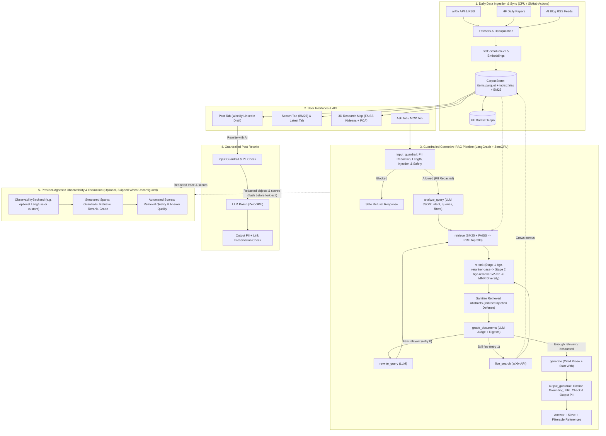

## How it's built

AI Research Navigator collects new AI papers and posts from free, open sources every day. It then helps you
decide what to read. Search finds items by keyword. The assistant reads your question, searches the
collection, keeps everything that is relevant and writes a short summary that cites the best of it,
followed by every matching reference.

Everything here is open source and runs on free tiers: Hugging Face Spaces with ZeroGPU for the app, a
Hugging Face dataset for storage and GitHub Actions for the daily collection. No paid API is involved.

### System architecture and data flow

### How a question becomes a reading list

1. **Understand the question.** The LLM (Qwen2.5-7B-Instruct) turns your question into one to three search
   queries. It also notes any time window ("this month") and whether you want papers or blog posts.
2. **Find candidates.** Each query runs through two searches: keyword search (BM25) and meaning-based search
   (FAISS over BGE embeddings). The two rankings are merged with Reciprocal Rank Fusion into a wide pool of
   up to 300 items (a limit on compute, not on results).
3. **Rerank.** A cross-encoder (bge-reranker-base) reads the question and each candidate together and scores
   how well they match. Every item above a relevance threshold is kept, so a broad question can return a
   hundred matches and a narrow one a handful. Recent items and Hugging Face upvotes get a small boost.
   Each reference shows its **match %**: the reranker's estimate that it is relevant to your question.
4. **Review.** The LLM reads the 10 best matches, drops any that are off-topic and writes a short summary
   of each one it keeps.
5. **Try again if needed.** If fewer than 3 items pass the review, the LLM rewords the search and steps 2–4
   repeat (only new items are reviewed). If that still isn't enough, the app searches arXiv live.
6. **Answer.** The LLM writes an overall summary from the reviewed items and cites them as [1], [2] and so
   on. Below it comes every match: reviewed items with the model's summary, the rest with their abstract.
   You always get at least 5 references: if fewer match, the closest low-scoring items fill the list,
   marked "Low match" under a warning, so a weak result is never presented as a strong one.
   The list is built straight from the collection, so its titles and links can't be made up.

On the Ask tab your question and the list's filters sit on the left, the results in the center and the
assistant's steps on the right. The steps panel (the "sieve") shows the real count at each step. Sort and
filter the references afterwards (relevance, newest, oldest, most upvoted; type, date, source) without
asking again; the [n] numbers stay attached to their items.

### The landing page and the research map

Before you ask anything, the center of the Ask tab opens on a 3D map of the papers, with the collection's size
underneath. Above the assistant's steps on the right, a chart of new papers per day covers the last 14 days,
with this week's count compared with the week before. The chart stays there while answers are shown.

The map follows Andrej Karpathy's "LLM wiki" idea, where notes link to the concept pages they belong to and to
one another, as in Obsidian's graph view. Here the collection builds the wiki itself, with no LLM and no extra
cost:

1. **Topics.** k-means clustering over the paper embeddings the search already uses finds up to 36 topics.
   Each topic is named by the title words that are most typical of it and rare elsewhere (tf-idf over titles).
2. **Links.** Every paper links to its topic and to its 4 nearest papers by meaning. A link is kept only if
   the pair is closer than 95% of random pairs, so the threshold suits whatever embedding model is in use.
3. **Layout.** A 3D projection of the embeddings (PCA) gives the starting positions, and a force layout
   settles them in the browser.

Drag to rotate, scroll to zoom and right-drag to pan. Click a paper to fly to it and see its nearest papers,
then click one of those to hop on. Click a topic, or one of the topic buttons above the map, to see its most
upvoted and newest papers. Newer papers are a stronger teal. The map covers up to 3,000 papers (upvoted ones
first, then the newest). It is rebuilt only when the collection changes and takes about a second on CPU.

### Interface

| Component | What it is | What it does in this project | Where |
|---|---|---|---|
| **Gradio** | A Python library for building web apps around ML models | Builds the whole interface: the tabs, the three-pane Ask desk, the reference list with its sort and filters, and the sieve. `gr.State` keeps the conversation per visitor without exposing it in the public API. Theme and CSS give the custom look. | `ai_news/ui.py`, `app.py` |
| **Gradio MCP server** + **`mcp`** | Model Context Protocol support built into Gradio; `mcp` is the protocol library it needs | Exposes the search and assistant functions as tools that other AI agents, such as Claude or Cursor, can call. The tool descriptions come from the functions' docstrings. | `app.py` (`mcp_server=True`) |
| **Google Fonts** (Newsreader, Hanken Grotesk) | Free web fonts | Newsreader, a serif made for screen reading, is used for titles, summaries and references. Hanken Grotesk is used for controls and metadata. | `ai_news/ui.py` |
| **3d-force-graph** (with **three.js**) | A WebGL library for interactive 3D force-directed graphs, built on three.js | Draws the research map: the orbit camera, fly-to animations, hover labels and the force layout. It loads from the jsDelivr CDN at a pinned version, so it is not a Python dependency. The page fetches the map data once through a Gradio server function, so the data is not part of the public API. | `ai_news/ui.py` (`MAP_JS`) |
| **Research map builder** | Our own code, using FAISS and NumPy | Reads the stored vectors back out of FAISS, clusters them into topics (`faiss.Kmeans`), names each topic by tf-idf over titles, links near neighbours (`IndexFlatIP`), projects to 3D with PCA and caches the result until the collection changes. | `ai_news/atlas.py` |
| **Iframe height reporter** | A small script in the page head (`FIT_JS`) | On huggingface.co the app runs inside an iframe that only grows when the app reports its height. Gradio's own reporter can stop growing after a few quick changes (a streaming answer, fonts loading), which left the page unable to scroll. The script measures the real content height and reports it whenever it changes. | `ai_news/ui.py`, `app.py` |

### Orchestration: LangChain and LangGraph

| Component | What it is | What it does in this project | Where |
|---|---|---|---|
| **LangGraph** | A library for building LLM workflows as graphs of steps with shared state | Runs the assistant as a `StateGraph` with seven nodes: analyze, retrieve, rerank, grade, rewrite, live search and generate. **Conditional edges** decide what happens after grading: answer, reword or search arXiv. **Streaming** sends each finished step to the page as it happens, which drives the sieve. | `ai_news/rag/graph.py`, `ai_news/rag/nodes.py`, `ai_news/rag/state.py` |
| **LangChain Core** (`langchain-core`) | The common interfaces of the LangChain ecosystem: messages, chat models and embeddings | Gives every model the same interface. The graph calls `llm.invoke([HumanMessage(...)])` whether the model runs locally or through an API. Tests swap in `FakeListChatModel` and `DeterministicFakeEmbedding`, so the whole pipeline is tested without downloading a model. | `ai_news/rag/nodes.py`, `tests/` |
| **`langchain-huggingface`** | LangChain's official Hugging Face integration | `HuggingFacePipeline` + `ChatHuggingFace` wrap the local transformers model with its chat template. `HuggingFaceEndpoint` is the alternative that calls the HF Inference API, for local development without a GPU. `HuggingFaceEmbeddings` produces the vectors used for search. | `ai_news/llm.py` |

### Models (all open weights, from the Hugging Face Hub)

| Component | What it is | What it does in this project | Where |
|---|---|---|---|
| **Qwen2.5-7B-Instruct** | A 7-billion-parameter open chat LLM from Alibaba's Qwen team | The "brain" of the assistant: it plans the searches, judges relevance, rewords searches and writes the cited answer. It returns structured JSON for the planning and judging steps. You can switch it with `LLM_MODEL_ID`, for example to Qwen2.5-3B on smaller GPUs. | `ai_news/llm.py`, `ai_news/rag/prompts.py` |
| **BAAI/bge-small-en-v1.5** | A small (33M parameter) embedding model that turns text into 384-number vectors | Embeds every title + abstract, and every search query, for meaning-based search. It is small enough to run on CPU, so the background collection needs no GPU. Queries get BGE's recommended retrieval prefix. | `ai_news/llm.py` (`load_embeddings`) |
| **BAAI/bge-reranker-base** + **BAAI/bge-reranker-v2-m3** | Two-stage Sentence-Transformers cross-encoder re-reranker + MMR diversity | Stage 1 (`bge-reranker-base`) scores the full RRF pool quickly; Stage 2 (`bge-reranker-v2-m3`, `max_length=1024`) re-reranks the top 40 candidates using the question and extracted intent; Stage 3 applies Maximal Marginal Relevance (MMR) over stored BGE embeddings so the top results are diverse and non-redundant. Stage 2 can be disabled via `RERANK_STAGE2_MODEL_ID=""`. | `ai_news/reranker.py`, `ai_news/rag/nodes.py` |
| **Transformers** | Hugging Face's library for loading and running models | Loads Qwen and its tokenizer and runs text generation. | `ai_news/llm.py` |
| **Accelerate** | Hugging Face's helper for placing models on devices | Used by transformers to load the large model efficiently onto the GPU. | (used by transformers) |
| **PyTorch** (`torch`) | The deep-learning framework all three models run on | Runs the neural networks, on the GPU in the Space and on CPU for the embeddings. | (used by all models) |
| **Sentence Transformers** | A library for embedding and cross-encoder models | Runs the BGE embedding model (through `HuggingFaceEmbeddings`) and the BGE reranker (`CrossEncoder`). | `ai_news/llm.py` |

### Search and ranking

| Component | What it is | What it does in this project | Where |
|---|---|---|---|
| **FAISS** (`faiss-cpu`) | Meta's library for fast similarity search over vectors | Stores one vector per item in an `IndexIDMap2(IndexFlatIP)`, which gives exact cosine similarity and lets items be added and removed by id. It finds the items closest in meaning to a query. The index is saved as `index.faiss` next to the data. | `ai_news/store.py` (`VectorIndex`) |
| **`rank-bm25`** | An implementation of BM25, the classic keyword-ranking formula used by search engines | Powers the Search tab, and the keyword half of the assistant's search. It catches exact model names and acronyms that embeddings can blur. | `ai_news/store.py`, `ai_news/search.py`, `ai_news/text.py` |
| **Reciprocal Rank Fusion** | A simple method for merging several rankings (score = sum of 1 / (60 + rank)) | Combines the BM25 and FAISS results into one candidate list without having to calibrate their very different scores. | `ai_news/rag/nodes.py` (`retrieve`) |
| **Recency and popularity boost** | Our own scoring | After reranking, an item's relevance is scaled up a little for being recent (half-life of 30 days) and for Hugging Face upvotes, so among equally relevant items fresh and widely discussed work comes first. | `ai_news/rag/nodes.py` (`rerank`) |

### Data sources and ingestion

| Component | What it is | What it does in this project | Where |
|---|---|---|---|
| **arXiv API** + **arXiv RSS** | arXiv's free query API and its daily announcement feeds | Provide the newest papers in cs.AI, cs.CL, cs.LG, cs.CV, cs.MA, cs.IR and stat.ML. Queries go one category at a time with a 3-second pause, because larger queries get rate-limited. The API also powers the assistant's live search. | `ai_news/fetchers/arxiv.py` |
| **Hugging Face Daily Papers API** | The community-curated paper feed at huggingface.co/papers | Adds hand-picked papers and their upvotes, which feed the popularity boost. | `ai_news/fetchers/hf_papers.py` |
| **Blog RSS feeds** | Feeds from Hugging Face, Google Research, DeepMind, OpenAI, Microsoft Research, BAIR, NVIDIA, AWS and others | Cover announcements and explainers that never appear on arXiv. The list is in `config/sources.yaml`, and new feeds can be added there. | `ai_news/fetchers/rss.py` |
| **feedparser** | A robust RSS/Atom parser | Reads the arXiv and blog feeds, including dates and authors. | `ai_news/fetchers/` |
| **HTTPX** | A modern HTTP client | Downloads every source with timeouts and retries, and backs off politely on HTTP 429 or 503, honouring `Retry-After`. | `ai_news/fetchers/common.py` |
| **PyYAML** (`pyyaml`) | A YAML parser | Reads `config/sources.yaml`, the editable list of sources. | `ai_news/fetchers/__init__.py` |
| **pandas** + **PyArrow** | Data-frame and columnar-file libraries | Save and load the collection as `items.parquet`, a compact, fast file format. | `ai_news/store.py` |
| **Deduplication** | Our own logic | One canonical URL per item, so arXiv versions, PDF links and HF paper pages of the same paper merge into a single entry, keeping the highest upvote count. Items older than 180 days are pruned. | `ai_news/schema.py`, `ai_news/store.py` |

### Hosting, storage and automation

| Component | What it is | What it does in this project | Where |
|---|---|---|---|
| **Hugging Face Spaces** | Free hosting for ML web apps | Hosts the Gradio app. | `README.md` (Space settings) |
| **ZeroGPU** (`spaces`) | A free, shared GPU pool for Spaces | Lends the app a GPU only while `@spaces.GPU` code runs. Here that is one assistant answer, with 75 seconds reserved, and each visitor uses their own daily GPU quota. The GPU code runs in a separate process, so the app resets its locks after the fork and sends results back as simple messages. | `app.py`, `ai_news/assistant.py`, `ai_news/store.py` |
| **Hugging Face Dataset repo** | A free versioned file store on the Hub | Keeps the latest `items.parquet`, `index.faiss` and `meta.json` at `shanudengre82/ai-news-corpus`. A restarted Space downloads it in seconds instead of rebuilding everything. | `ai_news/store.py` (`pull` / `push`) |
| **`huggingface_hub`** + **`hf` CLI** | The Python client and command-line tool for the Hub | `snapshot_download` and `upload_folder` move the data to and from the dataset; the CLI uploads the code to the Space. | `ai_news/store.py`, `.github/workflows/` |
| **GitHub Actions** | Free CI/CD from GitHub | `sync-to-hf.yml` deploys the code to the Space on every push. `refresh-corpus.yml` collects new items weekly (Mondays 06:00 UTC) on a CPU runner and pushes them to the dataset. | `.github/workflows/` |
| **Refresh scheduler & weekly map cache** | Background thread + `atlas.json` 7-day cache | Pulls/fetches on a weekly schedule (`REFRESH_HOURS=168`) and caches the 3D research map for `MAP_REFRESH_DAYS=7` days on disk so restarts and live searches do not rebuild the graph unnecessarily. | `ai_news/scheduler.py`, `ai_news/atlas.py` |
| **Inference token optimizer & LRU cache** | Per-node token caps, heuristic fast-path, confidence-gated grading, digest reuse, and `QueryCache` | Cuts LLM tokens by ~55–75% per query: tight per-node `max_new_tokens` budgets, heuristic query parsing for concise single-turn questions, skipping LLM grading when ≥3 high-confidence cross-encoder matches exist, reusing compact digests in `generate`, and serving repeat/example queries from an in-memory PII-safe LRU cache with zero ZeroGPU usage. | `ai_news/rag/nodes.py`, `ai_news/cache.py`, `app.py` |

### Guardrails, PII checks and observability

| Component | What it is | What it does in this project | Where |
|---|---|---|---|
| **Guardrails & PII checker** | Our own deterministic, dependency-free safety layer | Runs on every Ask and Post-rewrite boundary. Detects and redacts PII/secrets (emails, phone numbers, SSNs, Luhn-validated credit cards, IPv4s, API keys/JWTs) before text reaches the LLM or traces; blocks prompt-injection overrides and unsafe requests while allowing AI-safety research queries; sanitizes scraped abstracts against indirect prompt injection; and validates inline `[n]` citations and URLs on output. | `ai_news/guardrails.py`, `ai_news/rag/nodes.py`, `app.py` |
| **Provider-agnostic observability** (optional **Langfuse**) | Pluggable tracing and RAG evaluation interface (`ObservabilityBackend`) | Completely skipped with zero overhead or imports when unconfigured (e.g. when `LANGFUSE_PUBLIC_KEY` / `LANGFUSE_SECRET_KEY` are missing or `OBSERVABILITY_BACKEND=none`). When enabled (optional `pip install "langfuse>=3.0"` or a custom registered backend), captures PII-redacted node snapshots, LangChain generations, and automated retrieval/answer quality scores (`retrieval_*`, `answer_*`, `guardrail_*`). | `ai_news/observability.py`, `ai_news/assistant.py`, `app.py` |

### Quality checks

| Component | What it is | What it does in this project | Where |
|---|---|---|---|
| **pytest** | Python's standard testing tool | Tests the parsers on saved feed samples, the deduplication, search filters, the graph's routing (fake LLM), the error handling, the sieve and the fork safety. It also checks that this page names every dependency. | `tests/` |
| **`gradio_client`** | Gradio's Python client | `scripts/smoke_test.py` calls the running app or Space end to end: status, search and a full assistant answer. | `scripts/smoke_test.py` |
| **Playwright** | Browser automation (development only, not deployed) | Took screenshots at desktop and phone sizes in light and dark mode while the interface was being designed. | (local tooling) |

### Why these choices

- **Free and open.** Every model, library and service here is open source or has a free tier, so the
  project costs nothing to run.
- **Hybrid search.** BM25 finds exact terms, embeddings find related ideas, and the reranker reads both
  closely. Together they find better candidates than any one of them alone.
- **The LLM judges before it answers.** Grading each result first, and retrying when too few pass, keeps the
  answer grounded in sources that actually fit the question.
- **Trade-offs.** CPU embeddings keep collection free but slow, so a full refresh takes about 7–15 minutes on
  GitHub's runners. ZeroGPU is free but limited per visitor, so the assistant's GPU time is kept short;
  logged-in visitors get more. A 7B model gives good answers on the Space, while a 3B model is enough for
  local testing on a 12 GB GPU.
